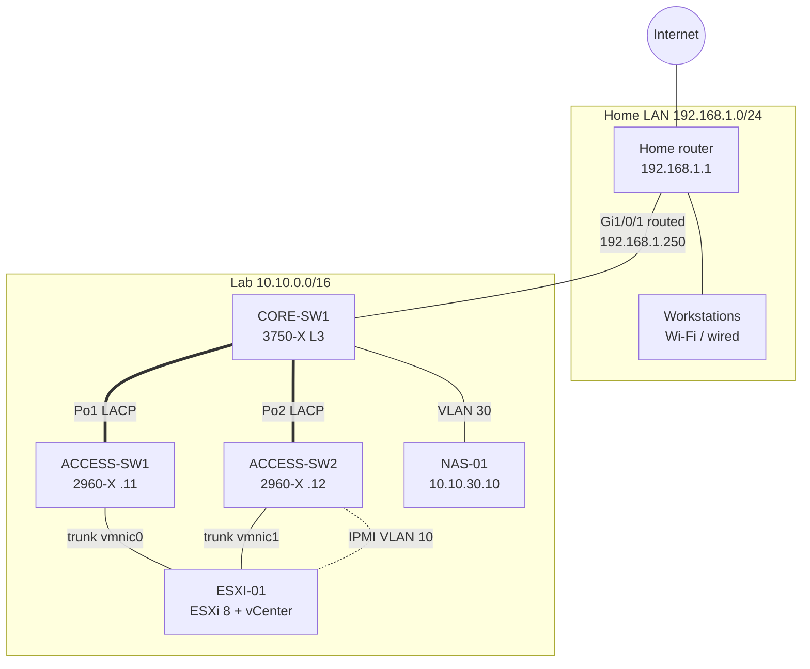

# CCNA + VMware Home Lab

A routed, VLAN-segmented home lab built on enterprise Cisco switching and a single-socket Supermicro server running ESXi 8 and vCenter. It is designed to practice CCNA topics (VLANs, 802.1Q trunking, LACP EtherChannel, Rapid PVST+, inter-VLAN routing, DHCP, SSH hardening) alongside vSphere administration (vSwitch design, VLAN-tagged port groups, vCenter, backups, and HA with a nested host).

## Hardware

| Role | Device |
|---|---|
| Layer 3 core | Cisco Catalyst 3750-X (IP Base) |
| Access layer | 2x Cisco Catalyst 2960-X |
| Hypervisor | Supermicro X10SRW-F, Xeon E5-2690 v4, 64 GB RAM, ESXi 8 |
| Backup target | WD MyCloud EX2 Ultra (RAID 1) |
| Edge | ISP home router (NAT, Wi-Fi, static route to the lab) |

## Topology



A more detailed version is in [`diagrams/topology.mmd`](diagrams/topology.mmd).

## VLANs

| VLAN | Name | Subnet | Gateway (CORE-SW1 SVI) | Purpose |
|---|---|---|---|---|
| 10 | MGMT | 10.10.10.0/24 | 10.10.10.1 | Switch management, ESXi vmk0, vCenter, IPMI |
| 20 | VM-NET | 10.10.20.0/24 | 10.10.20.1 | Guest VMs, DHCP .100 to .199 from CORE-SW1 |
| 30 | STORAGE | 10.10.30.0/24 | 10.10.30.1 | NAS, ESXi vmk1 |
| 999 | NATIVE-UNUSED | none | none | Native VLAN on all trunks, carries no traffic |

## Addressing

| Device | Interface | Address |
|---|---|---|
| CORE-SW1 | Gi1/0/1 (routed uplink) | 192.168.1.250/24, default route to 192.168.1.1 |
| CORE-SW1 | Vlan10 / 20 / 30 | 10.10.10.1 / 10.10.20.1 / 10.10.30.1 |
| ACCESS-SW1 | Vlan10 | 10.10.10.11 |
| ACCESS-SW2 | Vlan10 | 10.10.10.12 |
| ESXI-01 | vmk0 (VLAN 10) | 10.10.10.21 |
| vCenter (VCSA) | VLAN 10 port group | 10.10.10.22 |
| ESXI-03 (planned second host) | vmk0 / vmk1 | 10.10.10.23 / 10.10.30.23 |
| ESXI-N1 (nested) | vmk0 / vmk1 | 10.10.10.24 / 10.10.30.24 |
| ESXI-01 BMC | dedicated IPMI port | 10.10.10.30 |
| ESXI-03 BMC (planned) | dedicated IPMI port | 10.10.10.31 |
| veeam01 | VLAN 10 | 10.10.10.40 |
| TS-ROUTER (Tailscale subnet router) | VLAN 10 | 10.10.10.41 |
| RANCID-01 (config backups) | VLAN 10 | 10.10.10.42 |
| Service laptop | Gi1/0/22 on either access switch | 10.10.10.50 (static, temporary) |
| ESXI-01 | vmk1 (VLAN 30) | 10.10.30.21 |
| NAS-01 | LAN | 10.10.30.10 |

## Port map

| Switch | Port | Connects to | Mode |
|---|---|---|---|
| CORE-SW1 | Gi1/0/1 | Home router LAN | Routed |
| CORE-SW1 | Gi1/0/2 | NAS-01 | Access VLAN 30 |
| CORE-SW1 | Gi1/0/21-22 (Po1) | ACCESS-SW1 Gi1/0/23-24 | LACP trunk 10,20,30 native 999 |
| CORE-SW1 | Gi1/0/23-24 (Po2) | ACCESS-SW2 Gi1/0/23-24 | LACP trunk 10,20,30 native 999 |
| ACCESS-SW1 | Gi1/0/1 | ESXI-01 vmnic0 | Trunk 10,20,30, portfast trunk |
| ACCESS-SW2 | Gi1/0/1 | ESXI-01 vmnic1 | Trunk 10,20,30, portfast trunk |
| ACCESS-SW2 | Gi1/0/2 | ESXI-01 IPMI | Access VLAN 10 |
| ACCESS-SW1/2 | Gi1/0/22 | Service laptop | Access VLAN 10 |
| All | All other ports | none | Shutdown, VLAN 999 |

Planned for the second host (ESXI-03): ACCESS-SW1 Gi1/0/3 (vmnic0) and ACCESS-SW2 Gi1/0/3 (vmnic1) as trunks like Gi1/0/1, and its IPMI on ACCESS-SW1 Gi1/0/2. These ports are still shut in the committed configs; see [docs/07-vsphere-ha-cluster.md](docs/08-vsphere-ha-cluster.md#planned-switch-ports-for-esxi-03).

## Design highlights

- **Routed edge.** CORE-SW1's uplink is a routed port on the home subnet, with a default route to the home router and a return route for 10.10.0.0/16 on the router. The lab is isolated in its own address space but fully reachable from home workstations.
- **Redundant access uplinks.** Each 2960-X connects to the core over a two-port LACP EtherChannel, giving 2 Gbps per switch and surviving a single cable failure.
- **Trunk hygiene.** DTP disabled (`switchport nonegotiate`), an unused native VLAN (999), explicit allowed-VLAN lists, unused ports shut down and parked in VLAN 999.
- **Hardened management.** Local AAA, SSH v2 only with 2048-bit RSA, VTY access restricted by ACL to the home subnet and the management VLAN, Telnet disabled.
- **Host NIC redundancy without LACP.** The ESXi host's two NICs land on different, unstacked access switches, so vSwitch0 uses "Route based on originating virtual port" teaming rather than an EtherChannel.
- **Out-of-band access.** The BMC sits on its own dedicated port in VLAN 10, so the iKVM console survives a host network misconfiguration.
- **Three-layer backups.** vCenter file-based backup, ESXi config bundles, and Veeam Community Edition VM backups, each to its own least-privilege SMB share on the NAS.
- **vSphere HA cluster.** Two-host Lab-Cluster (ESXI-01 plus a nested ESXi host standing in for the second server) with shared NFS 3 storage over the storage VLAN, vMotion on the management VMkernel, per-VM EVC, DRS-driven maintenance mode, and tested host-failure and isolation responses.
- **Remote access without open ports.** A Tailscale subnet router VM advertises 10.10.0.0/16 and source-NATs remote traffic onto the management VLAN, so the switch ACLs and home router stay unchanged and nothing faces the internet.
- **Config change tracking.** RANCID collects all three switches hourly over SSH with a dedicated least-privilege account and commits only real changes to a git history, giving a diff of every change and a restorable last-good config.

## Build order

1. [Network design](docs/01-network-design.md)
2. [CORE-SW1](docs/02-core-sw1.md), config: [`configs/core-sw1.cfg`](configs/core-sw1.cfg)
3. [Home router](docs/03-home-router.md): DHCP range and static route to the lab
4. [ACCESS-SW1](docs/04-access-switches.md), config: [`configs/access-sw1.cfg`](configs/access-sw1.cfg)
5. [ACCESS-SW2](docs/04-access-switches.md), config: [`configs/access-sw2.cfg`](configs/access-sw2.cfg)
6. [ESXI-01 re-IP, IPMI and vCenter prep](docs/05-esxi-01-reip-vcenter-prep.md)
7. [NAS-01 backup target](docs/06-nas-backup.md)
8. [Nested HA member ESXI-N1](docs/07-nested-ha-esxi-n1.md): a nested second host to build the cluster with
9. [vSphere HA cluster](docs/08-vsphere-ha-cluster.md): NFS datastore, vMotion, HA, DRS, failure tests
10. [Ubuntu 26.04.1 VM build](docs/09-ubuntu-vm-build.md): TS-ROUTER and RANCID-01 on shared storage
11. [Tailscale remote access](docs/10-tailscale-remote-access.md): reach the lab from anywhere
12. [RANCID config backups](docs/11-rancid-config-backups.md): hourly switch config history in git

## Repository layout

```
configs/            Prompt-free IOS configs, ready to paste section by section
configs/optional/   DHCP reservations (MAC placeholders, fill in locally)
docs/               Build guides in Markdown
diagrams/           Mermaid topology source
ssh/                OpenSSH client config for IOS host keys
scripts/            Pre-commit secret scan
```

## Security notes

- Every credential in this repo is a placeholder (`<enable-password>`, `<admin-password>`, `<rancid-password>`). No password hashes, RSA keys, MAC addresses, serial numbers, Tailscale keys or machine names, or router credentials are committed.
- RANCID's output (`/var/lib/rancid`, its `.cloginrc`, and any `git bundle` of its history) contains password hashes and serial numbers. It stays on RANCID-01 and is blocked by `.gitignore`.
- All addresses are RFC 1918 private ranges.
- If you export a live `show running-config`, put it in `live-configs/` (git-ignored) and run [`scripts/check-secrets.sh`](scripts/check-secrets.sh) before committing anything derived from it.

## Author

Anthony M. Veliz
