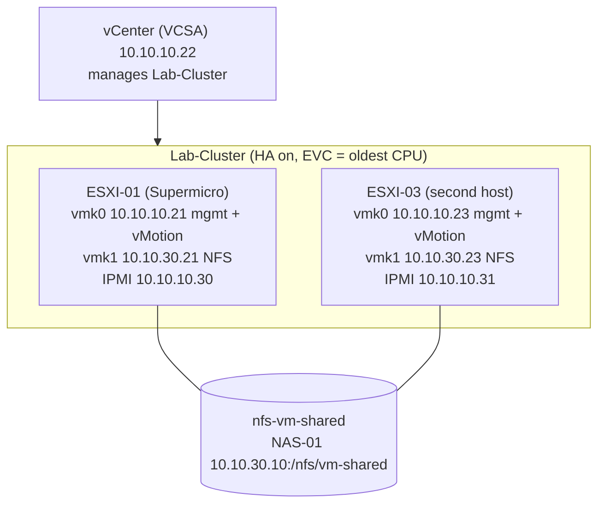

# 07. vSphere HA Cluster

Turns the single host into a two-host cluster that restarts VMs automatically when a host fails: the second host, the cluster, shared NFS storage on NAS-01, vMotion, enabling HA, and proving it works by powering a host off through IPMI. Use it once a second physical host arrives; until then, Part 1 helps pick hardware that fits, and [08-nested-ha-esxi-n1.md](08-nested-ha-esxi-n1.md) gives a nested stand-in.

## Design



HA restarts a failed host's VMs on the surviving host, which only works if both hosts can reach the VM's disks, so protected VMs live on the shared NFS datastore. vCenter stays on ESXI-01's local storage and is protected by its file-based backup ([06-nas-backup.md](06-nas-backup.md)).

## How vSphere HA works

- Enabling HA installs an agent (FDM) on every host. One host is elected **primary**; the others are secondaries.
- Hosts exchange network heartbeats over the management network every second. If a host goes silent, the primary also checks **datastore heartbeats** (small files each host updates on shared storage) to tell a dead host from one that has only lost its network.
- If the host is truly down, the primary restarts its VMs on the surviving host, usually within one to three minutes. It is a restart, not a live move, so the VM reboots.
- The agents run on their own once configured. HA keeps working if vCenter is down; only configuration changes need vCenter.

## Values

| Item | Value | Notes |
|---|---|---|
| Second host | ESXI-03 (esxi-03) | Placeholder name |
| ESXI-03 vmk0 | 10.10.10.23/24, gateway 10.10.10.1, VLAN 10 | Management + vMotion |
| ESXI-03 vmk1 | 10.10.30.23/24, VLAN 30, no gateway | Required for NFS |
| ESXI-01 vmk1 | 10.10.30.21/24, VLAN 30 | Optional in the re-IP guide, required here |
| ESXI-03 IPMI | 10.10.10.31/24, gateway 10.10.10.1 | Same method as ESXI-01's BMC |
| ESXI-03 switch ports (planned) | ACCESS-SW1 Gi1/0/3, ACCESS-SW2 Gi1/0/3; IPMI on ACCESS-SW1 Gi1/0/2 | Configure before cabling |
| NFS share | `vm-shared` on NAS-01, export usually `/nfs/vm-shared` | Separate from the SMB backup shares |
| Datastore | nfs-vm-shared | Must be identical on both hosts |
| Datacenter / cluster | Lab-DC / Lab-Cluster | |

Port numbers, the ESXI-03 name and its CPU generation are placeholders until the hardware arrives.

### Planned switch ports for ESXI-03

These mirror the existing ESXI-01 ports. Gi1/0/3 is currently in the unused, shut-down range on both access switches, so take it out of that range when you add it.

```
! ACCESS-SW1 and ACCESS-SW2 (use VMNIC0 on SW1, VMNIC1 on SW2)
interface GigabitEthernet1/0/3
 description ESXI-03-VMNIC0
 switchport mode trunk
 switchport trunk native vlan 999
 switchport trunk allowed vlan 10,20,30
 switchport nonegotiate
 spanning-tree portfast trunk
 spanning-tree bpduguard enable
 no shutdown
!
! ACCESS-SW1 only: ESXI-03 IPMI
interface GigabitEthernet1/0/2
 description ESXI-03-IPMI
 switchport mode access
 switchport access vlan 10
 spanning-tree portfast
 spanning-tree bpduguard enable
 no shutdown
```

## Part 1: Choose and prepare the second host

### Step 1: Pick hardware that fits

| Check | Why | Good choice |
|---|---|---|
| Intel, Broadwell (E5 v4) or newer | vMotion needs the same CPU vendor, and EVC can only lower the cluster to its oldest CPU. An older host drags ESXI-01 down, which is awkward while vCenter runs on it. | Xeon E5 v4, Xeon Scalable, or newer |
| On the ESXi 8 supported list | Older CPUs need an unsupported-install override and can block updates. Broadwell is the oldest family ESXi 8 still supports. | Check Broadcom's compatibility guide |
| 32 GB RAM or more | After a failure, the survivor must run every protected VM | 64 GB, like ESXI-01 |
| 2+ 1 GbE ports, plus a BMC | Redundant uplinks; IPMI for remote power-off testing | Dedicated IPMI port |
| Boot from SSD, not USB/SD | ESXi 8 wears out USB and SD boot media | Small SSD for boot + local datastore |

HA itself doesn't care about CPUs; vMotion and DRS do. Buying Broadwell or newer lets EVC stay at ESXI-01's level.

### Step 2: Build ESXI-03 like ESXI-01

Follow [05-esxi-01-reip-vcenter-prep.md](05-esxi-01-reip-vcenter-prep.md) on the new host with these substitutions:

| Re-IP guide step | ESXI-03 value |
|---|---|
| Part 1B, IPMI | 10.10.10.31, dedicated port, cabled to ACCESS-SW1 Gi1/0/2 (or a CORE-SW1 DHCP reservation) |
| DCUI | Both NICs, VLAN 10, 10.10.10.23/24, gateway 10.10.10.1, DNS 192.168.1.1, hostname esxi-03 |
| Cabling | vmnic0 to ACCESS-SW1 Gi1/0/3, vmnic1 to ACCESS-SW2 Gi1/0/3 |
| Certificate | Regenerate after setting the hostname |
| vSwitch0 | Same teaming; MGMT-VLAN10 and VM-NET with names identical to ESXI-01 |
| vmk1 | Required: 10.10.30.23/24 on port group Storage, VLAN 30 |
| NTP | pool.ntp.org, same as ESXI-01 and vCenter |

HA and vMotion match port groups **by name**, so a VM on MGMT-VLAN10 can only move to, or restart on, a host that also has a port group named exactly MGMT-VLAN10. If you skipped vmk1 on ESXI-01, add it now (10.10.30.21, VLAN 30, port group Storage).

## Part 2: Datacenter and cluster

3. **Datacenter.** In https://10.10.10.22/ui, right-click the vCenter and create **Lab-DC** (or reuse an existing one).
4. **Cluster.** Right-click Lab-DC > New Cluster, **Lab-Cluster**, with HA, DRS and vSAN **off**. Leave "Manage all hosts with a single image" unchecked (baselines are simpler for mixed hardware). Skip Quickstart; configuring each piece by hand shows what each does, and enabling HA last avoids a cluster full of warnings.
5. **Add hosts.** Move or add ESXI-01 (10.10.10.21), then add ESXI-03 (10.10.10.23) with root credentials. Keep existing VMs where they are. Both hosts should show connected with no red alarms.
6. **EVC.** Lab-Cluster > Configure > VMware EVC > Enable EVC for Intel Hosts:

| Older CPU in the cluster | EVC mode |
|---|---|
| Broadwell (ESXI-01's E5-2690 v4), or the new host is newer | Intel Broadwell Generation |
| Skylake or newer in both hosts | The older host's generation |
| New host older than Broadwell (e.g. Haswell E5 v3) | Intel Haswell Generation (see note) |

vCenter can't lower EVC below the features its own running VMs already use. With a Broadwell-or-newer second host, nothing needs a reboot. With an older host, running VMs on ESXI-01, including vCenter itself, must be power-cycled to adopt the lower baseline, which needs a separate procedure. Following Step 1 avoids that.

## Part 3: Shared NFS storage

### Step 7: Create the NFS share on NAS-01

1. Turn NFS on in the NAS network services.
2. Add share **vm-shared**: Public off, Media Serving off, Recycle Bin off.
3. Enable NFS access on the share:

| Option | Value | Why |
|---|---|---|
| Host | 10.10.30.0/24 (or 10.10.30.21 and 10.10.30.23) | Only the hosts' storage addresses can mount it |
| Permission | Read/Write | VMs write to their disks |
| Root squash | **Off** | ESXi mounts NFS as root; squash blocks writes |
| Write mode | Sync, if offered | Safer for VM disks on power loss |

Note the export path (usually `/nfs/vm-shared`). NFS is simpler than iSCSI (no LUNs, no VMFS) and is plenty for a few lab VMs over 1 GbE. Limiting access to VLAN 30 keeps the share off the home network.

### Step 8: Mount it on both hosts

Right-click Lab-Cluster > Storage > New Datastore: **NFS 3**, name **nfs-vm-shared**, folder `/nfs/vm-shared`, server 10.10.30.10, and select both hosts. Mounting from the cluster guarantees the same name and server everywhere.

```
[root@esxi-01:~] vmkping -I vmk1 10.10.30.10
[root@esxi-01:~] esxcli storage nfs list
Volume Name    Host         Share           Accessible  Mounted  Read-Only
nfs-vm-shared  10.10.30.10  /nfs/vm-shared  true        true     false
```

Expect Accessible true, Mounted true, Read-Only false on both hosts. Traffic stays inside VLAN 30, so nothing is routed.

> **Same NAS as backups.** NAS-01 also holds the backups. Keep only test VMs and lab VMs you can rebuild on nfs-vm-shared, or back them up somewhere else, or one NAS failure takes a VM and its backup together.

## Part 4: vMotion

9. On each host: Configure > Networking > VMkernel adapters > vmk0 > Edit, and add **vMotion** (Management stays on). Sharing vmk0 needs no new VLAN; a dedicated vMotion VLAN is the production practice and an easy upgrade later.
10. **Test.** Create TEST-HA01 (Alpine or Ubuntu Server, 1 vCPU, 1 GB) on nfs-vm-shared, port group VM-NET. With a continuous ping running, Migrate > Change compute resource only to the other host. It should complete in seconds with at most one dropped ping, which proves shared storage, matching port groups, EVC and vMotion together.

## Part 5: Enable vSphere HA

### Step 11: Settings

Lab-Cluster > Configure > Services > vSphere Availability > Edit:

| Setting | Value | Why |
|---|---|---|
| Host Monitoring | On | Heartbeats that detect a failed host |
| Host failure response | Restart VMs | The core HA action |
| Host isolation response | Power off and restart VMs | Right choice with NFS: an isolated host's VMs restart where they can be reached |
| Datastore with PDL / APD | Power off and restart VMs (conservative) | Recovers VMs if a host loses the datastore |
| VM Monitoring | Disabled for now | Guest-hang restarts can surprise you while learning |
| Admission Control | Cluster resource percentage, 1 host failure (50%) | Reserves room for one host's VMs; or Disabled in a lab, at the risk of failed restarts |
| Heartbeat datastores | Specified list: nfs-vm-shared | Only shared datastores count |

Watch Recent Tasks until both hosts show "Configuring vSphere HA" completed.

### Step 12: Heartbeat datastore warning

HA wants two shared heartbeat datastores. Either:

- **Best practice:** create `vm-shared2` like Step 7, mount it as nfs-vm-shared2 on both hosts, and add it to the heartbeat list (it can stay nearly empty), or
- **Lab:** add advanced option `das.ignoreInsufficientHbDatastore = true`.

With a single NAS both shares fail together anyway, so the second share adds less here than in production.

A healthy cluster (Monitor > vSphere HA > Summary) shows a primary host, 2 hosts connected, no configuration issues, and TEST-HA01 as Protected. VMs on local datastores, such as vCenter, show as unprotected; that's expected. vSphere Cluster Services (vCLS) agent VMs may appear depending on the vCenter 8 build; leave them alone.

## Part 6: Test

13. **Fail a host.** With TEST-HA01 on ESXI-03 and a ping running, open ESXI-03's IPMI (https://10.10.10.31) and choose **Power Off Immediately**. Watch ESXI-03 go Not Responding and TEST-HA01 restart on ESXI-01 within one to three minutes; Monitor > Events shows the HA restart. Power ESXI-03 back on through IPMI and it rejoins. Never test by powering off ESXI-01 while vCenter lives only on its local storage.
14. **Maintenance mode.** Enable DRS in Partially automated mode (included in the evaluation), put ESXI-03 into maintenance mode, accept the vMotion recommendations, then exit maintenance mode. This is the everyday use of a cluster: emptying a host before patching with no VM downtime.

## Troubleshooting

| Symptom | Likely cause | Fix |
|---|---|---|
| NFS mount: access denied | Host list excludes 10.10.30.x, or root squash on | Recheck Step 7; include both vmk1 addresses |
| NFS mount: unable to connect | No vmk1, wrong VLAN, NFS off | `vmkping -I vmk1 10.10.30.10`; Storage port group VLAN 30 |
| Datastore shows twice or with different names | Mounted per host differently | Unmount, remount from the cluster |
| vMotion: incompatible CPU | EVC off or too high | Set EVC to the older generation |
| vMotion: network not found | Port group names differ | Identical names on both hosts |
| HA: insufficient heartbeat datastores | Only one shared datastore | Step 12 |
| HA: no management network redundancy | One uplink on vSwitch0 | Add the second vmnic as active |
| HA: insufficient resources for failover level | Admission control can't reserve 50% | Lower reservations, add RAM, or disable in the lab |
| Test VM didn't restart | VM on local storage, or HA not configured on a host | Keep protected VMs on nfs-vm-shared; check Monitor > vSphere HA |
| Host isolated after a network blip | Gateway 10.10.10.1 briefly unreachable | Normal reaction; check uplinks and CORE-SW1 if it repeats |

**Licensing.** HA and DRS are included in the 60-day evaluation. For a longer-lived lab, use a legitimate lab license such as VMUG Advantage. The free ESXi edition can't join vCenter, so it can't be part of a cluster.
