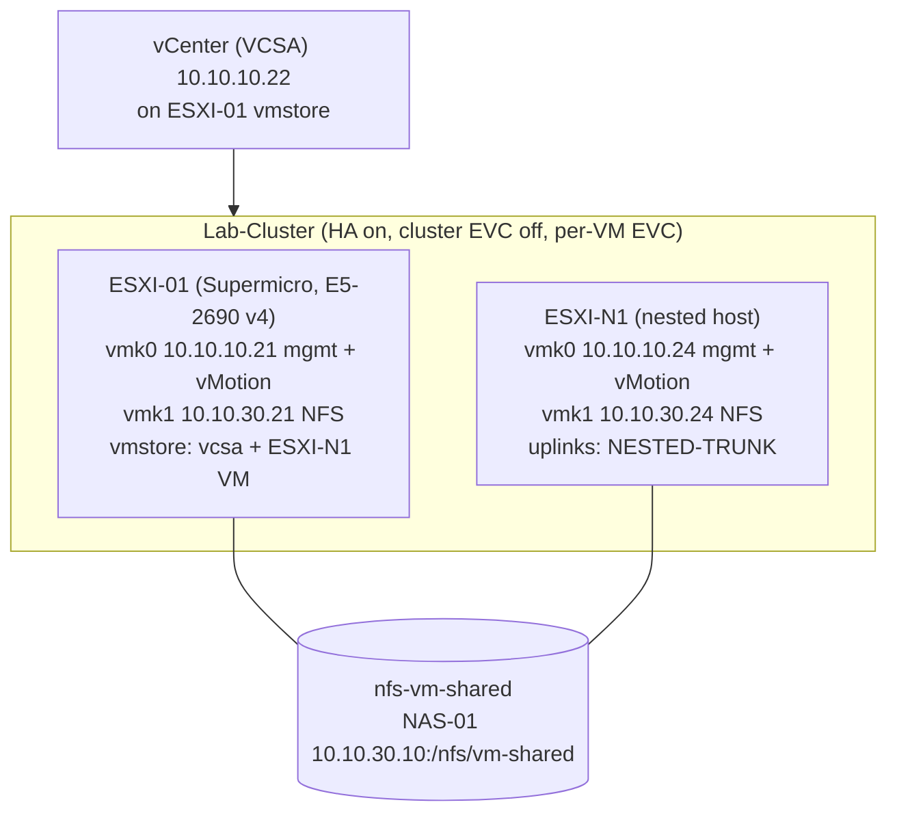

# 08. vSphere HA Cluster

Turns ESXI-01 and the nested host ESXI-N1 into a two-host cluster that restarts VMs automatically when a host fails: the cluster, shared NFS storage on NAS-01, vMotion, HA with lab settings, and proof that it works by failing ESXI-N1 on purpose. Start once ESXI-N1 is built and checked with [07-nested-ha-esxi-n1.md](07-nested-ha-esxi-n1.md), Steps 1 to 8. Part 7 covers swapping in a physical second host later.

## Design



HA restarts a failed host's VMs on the surviving host, which only works if both hosts can reach the VM's disks, so protected VMs live on the shared NFS datastore. vcsa and the ESXI-N1 VM stay on ESXI-01's local storage; vCenter is protected by its file-based backup ([06-nas-backup.md](06-nas-backup.md)).

## How vSphere HA works

- Enabling HA installs an agent (FDM) on every host. One host is elected **primary**; the others are secondaries.
- Hosts exchange network heartbeats over the management network every second. If a host goes silent, the primary also checks **datastore heartbeats** (small files each host updates on shared storage) to tell a dead host from one that has only lost its network.
- If the host is truly down, the primary restarts its VMs on the surviving host, usually within one to three minutes. It is a restart, not a live move, so the VM reboots.
- The agents run on their own once configured. HA keeps working if vCenter is down; only configuration changes need vCenter.

## Values

| Item | Value | Notes |
|---|---|---|
| ESXI-01 vmk0 | 10.10.10.21/24, gateway 10.10.10.1, VLAN 10 | Physical host |
| ESXI-01 vmk1 | 10.10.30.21/24, VLAN 30, no gateway | Optional in the re-IP guide, required here |
| ESXI-N1 vmk0 | 10.10.10.24/24, gateway 10.10.10.1, VLAN 10 | Nested guide Step 7 |
| ESXI-N1 vmk1 | 10.10.30.24/24, VLAN 30, no gateway | Nested guide Step 8f |
| vCenter | 10.10.10.22 (vcsa) | On ESXI-01's vmstore |
| NFS share | `vm-shared` on NAS-01, export usually `/nfs/vm-shared` | Separate from the SMB backup shares |
| Datastore | nfs-vm-shared | Must be identical on both hosts |
| Datacenter / cluster | Lab-DC / Lab-Cluster | Lab-DC already exists from adding ESXI-01 |
| Test VM | TEST-HA01 on nfs-vm-shared, network VM-NET | Small Linux VM |

## Part 1: Check both hosts are ready

### Step 1: Confirm ESXI-N1 is finished

| Check | Expected | Set in |
|---|---|---|
| Host Client | https://10.10.10.24/ui loads | Nested Step 7 |
| Hostname | esxi-n1.lab.local, certificate regenerated after setting it | 8b |
| NTP | Running, Time Synchronized true | 8c |
| Port groups | MGMT-VLAN10 (10), Management Network (10), VM-NET (20), Storage (30) | 8d to 8f |
| Storage path | `vmkping -I vmk1 10.10.30.10` replies | 8g |
| Uplinks | vmnic0 and vmnic1, both active on vSwitch0 | 5, 7, 8h |
| Nested virtualization | ESXI-N1 VM > CPU: Expose hardware assisted virtualization ticked | 5 |
| SSH | Disabled again | 8g |

### Step 2: ESXI-01 has its storage port (vmk1)

ESXI-01 > Configure > Networking > VMkernel adapters. If there's no vmk1 at 10.10.30.21, add it: new port group **Storage** on vSwitch0, VLAN 30, static 10.10.30.21/24, default TCP/IP stack, no services. Check with `vmkping -I vmk1 10.10.30.10` (SSH on, then off again). Without vmk1, ESXI-01 would reach the NAS through its gateway, and the share only allows 10.10.30.x addresses.

### Step 2b: ESXI-01 has the same VM port groups as ESXI-N1

On 10.10.10.21 > Configure > Networking > Virtual switches > vSwitch0:

| Port group | VLAN | Used by |
|---|---|---|
| MGMT-VLAN10 | 10 | vcsa and management VMs |
| VM-NET | 20 | TEST-HA01 and other test VMs |

Add any that's missing (Add Networking > Virtual Machine Port Group > existing vSwitch0), and rename near-misses such as `VM-Net` or `VM Network 20`. vMotion and HA match networks by port group name, letter for letter; a mismatch fails with *'Network adapter 1' uses network 'VM-NET', which is not accessible*.

## Part 2: Create the cluster

3. **Datacenter.** Lab-DC already exists from adding ESXI-01; create it only if missing.
4. **Cluster.** Right-click Lab-DC > New Cluster, **Lab-Cluster**, with HA, DRS and vSAN **off**. Leave "Manage all hosts with a single image" unchecked. Skip Quickstart; configuring each piece by hand shows what each does, and enabling HA last avoids a cluster full of warnings.
5. **Add hosts.** Drag ESXI-01 onto Lab-Cluster (keep its VMs in the root resource pool; vcsa and the ESXI-N1 VM keep running). Then Add Hosts > 10.10.10.24 with ESXI-N1's root password, accept the certificate, keep the evaluation or lab license. If a host shows *(Maintenance Mode)* after joining, exit maintenance mode. ESXI-N1 appearing twice is expected: once as a host (10.10.10.24) and once as a VM under ESXI-01.
6. **Leave cluster EVC off; use per-VM EVC.** Lab-Cluster > Configure > VMware EVC should read Disabled; leave it. Broadwell EVC fails on ESXI-N1 (its virtual CPU doesn't pass every Broadwell feature), and a lower mode such as Haswell fails on ESXI-01 because vcsa and the ESXI-N1 VM already run there with full Broadwell features. Both hosts share the same physical CPU, so vMotion and HA still work; each VM that needs to move gets **per-VM EVC (Intel Haswell)** instead, set while it's powered off (Step 14). When a physical host replaces ESXI-N1, turn on cluster EVC at Broadwell after ESXI-N1 is removed.

## Part 3: Shared NFS storage

### Step 7: Create the NFS share on NAS-01

1. My Cloud dashboard > Settings > Network > Network Services: **NFS Service ON** (otherwise NFS Access on a share stays greyed out).
2. Shares > add share:

| Setting | Value | Why |
|---|---|---|
| Share Name | `vm-shared` | Becomes `/nfs/vm-shared` |
| Public | OFF | Public shares let anyone on the network in |
| Recycle Bin | OFF | Deleted VM files should really be deleted |
| Oplocks | Leave ON | SMB setting; NFS ignores it |
| Mobile & Web App Access | OFF | Keeps VM files off the app and remote access |
| FTP Access | OFF | Not needed |
| NFS Access | ON | Opens the NFS settings |
| NFS Host | 10.10.30.0/24 | Only the storage VLAN (both hosts' vmk1) can mount |
| NFS Write | ON | VMs write to their disks |

Leave User Access at Deny for every NAS user: NFS doesn't use the NAS accounts at all, only the Host list.

### Step 8: Mount it on both hosts

The NAS shows the mount point as `nfs://10.10.30.10/nfs/vm-shared`; vCenter wants it split. Right-click Lab-Cluster > Storage > New Datastore: **NFS 3**, name **nfs-vm-shared**, folder `/nfs/vm-shared`, server 10.10.30.10, Bind to vmknic **unchecked** (vmk1 is already on the NAS subnet), Mount read-only **unchecked**, and tick both 10.10.10.21 and 10.10.10.24. Ignore the "Mount to additional hosts" banner.

Check, in order:

| # | Where | Expect | Proves |
|---|---|---|---|
| 1 | Recent Tasks | Create NAS datastore completed per host | Both mounts ran |
| 2 | Storage inventory > Lab-DC | nfs-vm-shared listed once, no warning icon | One shared datastore |
| 3 | nfs-vm-shared > Summary | NFS 3, 10.10.30.10, `/nfs/vm-shared` | Right share |
| 4 | nfs-vm-shared > Hosts | Both hosts, mounted and accessible | Both reach the NAS over vmk1 |
| 5 | Each host > Storage > Datastores | nfs-vm-shared on both | Same name everywhere |
| 6 | Files > New Folder `write-test`, upload a small file | No permission error | Write is ON, root can write |
| 7 | My Cloud > Shares > vm-shared | Usage goes up | Files landed on NAS-01 |
| 8 | Delete `write-test` | Gone, usage drops | Delete works |
| 9 | Lab-Cluster > Monitor > Issues and Alarms | No storage alarms | vCenter is happy |

Optional over SSH: `esxcli storage nfs list` shows Accessible true, Mounted true, Read-Only false. Traffic stays inside VLAN 30, so nothing is routed.

> **Same NAS as backups.** Keep only test VMs and lab VMs you can rebuild on nfs-vm-shared, or back them up somewhere other than NAS-01.

## Part 4: vMotion and power-on order

9. **vMotion on vmk0.** On each host: Configure > Networking > VMkernel adapters > vmk0 > Edit, add **vMotion** (Management stays on). A dedicated vMotion VLAN is the production practice and an easy upgrade later.
10. **Power-on order after an outage (reference).** Once ESXI-01 is in an HA cluster, ESXi disables its own VM autostart and the Startup/Shutdown list stays empty; leave it. After a power cut or reboot of ESXI-01:
    1. Open ESXI-01's Host Client (vCenter isn't up yet) and power on **vcsa**.
    2. Wait until https://10.10.10.22/ui accepts a login (about 10 to 15 minutes).
    3. Power on the **ESXI-N1 VM**; the host rejoins Lab-Cluster on its own.
    4. Power on test VMs last. If NAS-01 is still booting, wait for nfs-vm-shared to show accessible first.

    To shut down cleanly, reverse it: test VMs, then the ESXI-N1 VM (Shut Down Guest OS), then vcsa.

## Part 5: Turn on vSphere HA

### Step 11: Enable HA with lab settings

Lab-Cluster > Configure > Services > vSphere Availability > Edit:

| Setting | Lab value | Why |
|---|---|---|
| Host Monitoring | On | Heartbeats that detect a failed host |
| Host failure response | Restart VMs | The core HA action |
| Host isolation response | Power off and restart VMs | Right choice with NFS |
| Datastore with PDL / APD | Power off and restart VMs (conservative) | Recovers VMs if a host loses the datastore |
| VM Monitoring | Disabled | Keep the test focused on host failure |
| Admission Control | **Disabled** | ESXI-N1 (12 GB) can't hold half of ESXI-01's load, so a 50% reservation would block power-ons |
| Heartbeat datastores | Specified list: nfs-vm-shared | Only shared datastores count |

Watch Recent Tasks until both hosts show "Configuring vSphere HA" completed.

### Step 12: Keep vcsa and the ESXI-N1 VM out of HA

VM Overrides > Add is greyed out until HA or DRS is on, so do this now. Add an override for the **ESXI-N1 VM** (not the host) and **vcsa**, tick Override next to **VM Restart Priority** and choose **Disabled**. Leave every other override unchecked; DRS automation level is set later in Step 17. Both VMs live on local vmstore, so HA couldn't restart them elsewhere anyway; the override makes that explicit and silences warnings.

### Step 13: Heartbeat datastore warning

Advanced Options > Add `das.ignoreInsufficientHbDatastore = true`. If the warning stays, right-click **each host** > Reconfigure for vSphere HA (it's a host action, not a cluster one). A second share on the same NAS would clear the warning the textbook way, but both shares would fail together anyway.

A healthy cluster (Monitor > vSphere HA > Summary) shows a primary host, 2 hosts connected, no configuration issues; vcsa and the ESXI-N1 VM show as unprotected, which is expected. vSphere Cluster Services (vCLS) may appear depending on the vCenter 8 build; leave it alone.

## Part 6: Test it

In vCenter, 10.10.10.21 is ESXI-01, 10.10.10.24 is the ESXI-N1 host, and the item named ESXI-N1 with a VM icon is the nested host's VM. Do all of Part 6 in vCenter; per-VM EVC and HA only exist there.

### Step 14: Build TEST-HA01 on ESXI-N1

1. Upload a small Linux ISO (Ubuntu Server or Alpine) to an `ISO` folder on nfs-vm-shared so either host can boot it.
2. Right-click 10.10.10.24 > New Virtual Machine:

| Wizard page | Choose |
|---|---|
| Name and folder | TEST-HA01, location Lab-DC itself (not the Discovered or vCLS folders) |
| Compute resource | Lab-Cluster > 10.10.10.24 |
| Storage | **nfs-vm-shared**, not ESXI-N1's local datastore1 |
| Compatibility | ESXi 8.0 and later |
| Guest OS | Linux > Ubuntu Linux (64-bit) (Alpine: Other 5.x or later Linux) |
| CPU / Memory | 1 vCPU; 2 GB for Ubuntu (1 GB for Alpine) |
| Disk | 16 GB thin for Ubuntu (8 GB for Alpine) |
| Network | VM-NET, VMXNET 3, Connect At Power On |
| CD/DVD | Datastore ISO File on nfs-vm-shared, Connect At Power On |

3. **Per-VM EVC before first power-on:** TEST-HA01 > Configure > VMware EVC > Edit > Enable EVC for Intel hosts, **Intel Haswell Generation**.
4. Install the OS (VM-NET gets DHCP from CORE-SW1), install open-vm-tools if offered, then disconnect the CD/DVD.
5. Note its IP from Summary and start a continuous ping (`ping -t <IP>` on Windows, `ping <IP>` on macOS).

Lab-Cluster > Monitor > vSphere HA should now list TEST-HA01 as **Protected**.

### Step 15: Test vMotion

With TEST-HA01 running on 10.10.10.24 and the ping going: Migrate > Change compute resource only > 10.10.10.21, VM-NET to VM-NET, high priority. Then migrate it back.

| # | Where | Expect |
|---|---|---|
| 1 | Recent Tasks | Relocate virtual machine completed, usually under a minute |
| 2 | TEST-HA01 > Summary | New host, still Powered On |
| 3 | Destination host > VMs | TEST-HA01 listed there |
| 4 | Ping window | At most one or two lost replies |
| 5 | Console: `uptime` | Keeps counting (live move, not a reboot) |
| 6 | Monitor > Events | Migration ... completed |
| 7 | Lab-Cluster > Summary | Total vMotion Migrations up by one |

Both directions passing proves shared storage, matching port groups, per-VM EVC and vMotion on vmk0. Leave it on 10.10.10.24.

### Step 16: Fail ESXI-N1

With TEST-HA01 protected and running on 10.10.10.24, select the **ESXI-N1 VM** (under 10.10.10.21) > Power > Power Off. Don't touch anything else.

| Time (approx.) | What happens |
|---|---|
| 0 s | ESXI-N1 powers off; TEST-HA01 stops with it; ping times out |
| 10 to 20 s | Network heartbeats stop; the primary checks the datastore heartbeat; 10.10.10.24 goes Not Responding |
| 30 to 60 s | HA declares the host failed and powers TEST-HA01 on at 10.10.10.21 |
| 1 to 3 min | The guest boots, gets its DHCP address, ping resumes at the same IP |

Confirm: TEST-HA01 on 10.10.10.21, Events shows *vSphere HA restarted virtual machine TEST-HA01*, `uptime` reset (unlike Step 15), host alarms for 10.10.10.24 while it's down. Power the ESXI-N1 VM back on and the cluster heals to 2 hosts; reconfigure HA on 10.10.10.24 if a warning lingers. HA doesn't move VMs back.

**Isolation test:** vMotion TEST-HA01 back to ESXI-N1, then disconnect both of the ESXI-N1 VM's network adapters while it runs. HA's isolation response powers TEST-HA01 off there and restarts it on ESXI-01. Reconnect afterward.

**Never fail ESXI-01.** vCenter and ESXI-N1 both run on it, so nothing could take over.

### Step 17: Maintenance mode with DRS

Only ever put **10.10.10.24** into maintenance mode, never 10.10.10.21 (its local VMs can't move).

1. vMotion TEST-HA01 back to 10.10.10.24 and keep the ping running.
2. **Turn on DRS:** vSphere DRS > Edit, on, **Partially Automated**, migration threshold default (3), Predictive DRS off, **Virtual Machine Automation checked** (needed for per-VM overrides), DPM off.
3. **Overrides:** VM Overrides > select ESXI-N1 and vcsa > Edit > vSphere DRS automation level **Disabled**, keeping the HA restart priority Disabled from Step 12.
4. **Enter maintenance mode** on 10.10.10.24, keep "move powered-off VMs" ticked, and OK the warning about powered-on VMs (keeping TEST-HA01 running is the point). The task waits at a low percentage.
5. **Apply the recommendation:** Monitor > vSphere DRS > Recommendations shows TEST-HA01 moving to 10.10.10.21 because the host is entering maintenance mode. Apply it.
6. **Check:** 10.10.10.24 shows (Maintenance Mode) with no powered-on VMs, TEST-HA01 is on 10.10.10.21, the ping barely blinked, `uptime` didn't reset, and the vMotion count went up by one.
7. **Exit maintenance mode.** HA shows 2 hosts again within a minute or two.

This is the everyday use of a cluster: emptying a host before patching with no VM downtime. DRS can stay on; the overrides keep it away from vcsa and the ESXI-N1 VM.

## Part 7: When a physical second host arrives

| Check before buying | Good choice | Why |
|---|---|---|
| Intel, Broadwell (E5 v4) or newer | Xeon E5 v4, Xeon Scalable, or newer | Matches EVC Broadwell, so nothing needs a reboot |
| On the ESXi 8 supported list | Check Broadcom's compatibility guide | Older CPUs need overrides and can block updates |
| 32 GB RAM or more | 64 GB, like ESXI-01 | The survivor must run every protected VM |
| 2+ 1 GbE ports plus a BMC | Dedicated IPMI port | Redundant uplinks; IPMI for power-off tests |
| Boot from SSD, not USB/SD | Small SSD | ESXi 8 wears out USB and SD media |

1. Build it as **ESXI-03** with [05-esxi-01-reip-vcenter-prep.md](05-esxi-01-reip-vcenter-prep.md): vmk0 10.10.10.23, vmk1 10.10.30.23, IPMI 10.10.10.31, same port group names as ESXI-01. Configure its switch ports first (below).
2. Add it to Lab-Cluster, mount nfs-vm-shared on it, enable vMotion on its vmk0.
3. Put the ESXI-N1 host in maintenance mode, then Remove from Inventory.
4. Power off and Delete from Disk the ESXI-N1 VM, and remove its VM overrides.
5. Remove 10.10.30.24 from the NFS host list if listed individually, and delete NESTED-TRUNK on ESXI-01.
6. Turn on cluster EVC at **Intel Broadwell Generation**, re-enable admission control (cluster resource percentage, 50%), and fail-test the new host by powering it off through its IPMI.

### Planned switch ports for ESXI-03

These mirror the existing ESXI-01 ports. Gi1/0/3 on both access switches, and Gi1/0/2 on ACCESS-SW1, are in the unused, shut-down ranges of the committed configs, so take them out of those ranges when you add them.

```
! ACCESS-SW1 and ACCESS-SW2 (VMNIC0 on SW1, VMNIC1 on SW2)
interface GigabitEthernet1/0/3
 description ESXI-03-VMNIC0
 switchport mode trunk
 switchport trunk native vlan 999
 switchport trunk allowed vlan 10,20,30
 switchport nonegotiate
 spanning-tree portfast trunk
 spanning-tree bpduguard enable
 no shutdown
!
! ACCESS-SW1 only: ESXI-03 IPMI
interface GigabitEthernet1/0/2
 description ESXI-03-IPMI
 switchport mode access
 switchport access vlan 10
 spanning-tree portfast
 spanning-tree bpduguard enable
 no shutdown
```

## Troubleshooting

| Symptom | Likely cause | Fix |
|---|---|---|
| NFS mount: access denied | Host field doesn't cover 10.10.30.x, or NFS Service off | Host 10.10.30.0/24, NFS Service ON |
| Datastore read-only, New Folder fails | NFS Write OFF, or the NAS squashes root | Shares > vm-shared > NFS Access > Configure, Write ON |
| Datastore on only one host | That host's vmk1 missing or wrong VLAN | Fix vmk1, then Mount Datastore to Additional Hosts |
| NFS mount: unable to connect | No vmk1, wrong VLAN, NFS off | `vmkping -I vmk1 10.10.30.10` on each host |
| Datastore shows twice / different names | Mounted per host differently | Unmount, remount from the cluster |
| Cluster EVC: host CPU lacks required features | Expected with a nested host | Leave cluster EVC off (Step 6) |
| "uses network VM-NET, which is not accessible" | Port group missing or named differently on the destination | Step 2b |
| vMotion back to ESXI-N1: CPU incompatible | No per-VM EVC, VM powered on at ESXI-01 | Power off, set per-VM EVC Haswell, power on |
| "does not support Intel VT-x ... VHV disabled" | ESXI-N1 VM lacks hardware-assisted virtualization | Maintenance mode on .24, shut down the ESXI-N1 VM, tick it, power on |
| Maintenance mode stuck at a low % | Partially Automated DRS waiting | Apply Recommendations (Step 17) |
| DRS automation override greyed out | DRS off, or VM Automation unchecked | Step 17, item 2 |
| Insufficient failover resources | Admission control on | Disable it (Step 11) |
| Insufficient heartbeat datastores | One shared datastore | Step 13 |
| Can't find Reconfigure for vSphere HA | It's on each host's menu, not the cluster's | Right-click the host |
| Startup/Shutdown list empty, banner says disabled | ESXi disables autostart in HA clusters | Use the order in Step 10 |
| VM Overrides > Add greyed out | Neither HA nor DRS on | Enable HA first |
| Host in (Maintenance Mode) after joining | Joined in maintenance mode | Exit maintenance mode |
| No management network redundancy (NICs: 1) | ESXI-N1 has one adapter, or vmnic1 not active | Nested guide Step 8h |
| TEST-HA01 didn't restart | VM on local storage, or HA not configured on a host | Keep it on nfs-vm-shared; check Monitor > vSphere HA |
| TEST-HA01 restarted but no network | NESTED-TRUNK security not Accept | Nested guide Step 3 |
| Host isolated after a network blip | Gateway briefly unreachable | Normal; check uplinks if it repeats |
| DUP! ping replies | Promiscuous mode with two vNICs | Harmless |

**Licensing.** HA and DRS are included in the 60-day evaluation. For a longer-lived lab, use a legitimate lab license such as VMUG Advantage. The free ESXi edition can't join vCenter, so it can't be part of a cluster.
