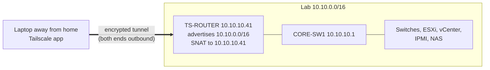

# 10. Remote Access with Tailscale

Reach the switches, ESXi, vCenter, IPMI and the NAS from any network outside the house. A small Ubuntu VM on the cluster, **TS-ROUTER**, runs Tailscale as a **subnet router** for 10.10.0.0/16; laptops run the Tailscale app. Nothing changes on the home router and **no ports are opened to the internet**: both ends of the encrypted WireGuard tunnel connect outbound.



## What you can reach

| Device | Address | How |
|---|---|---|
| CORE-SW1 | 10.10.10.1 | `ssh admin@10.10.10.1` |
| ACCESS-SW1 / SW2 | 10.10.10.11 / .12 | `ssh admin@10.10.10.11` |
| ESXI-01 Host Client | 10.10.10.21 | https://10.10.10.21 |
| vCenter | 10.10.10.22 | https://10.10.10.22/ui |
| ESXI-N1 (nested) | 10.10.10.24 | https://10.10.10.24 |
| ESXI-01 IPMI | 10.10.10.30 | https://10.10.10.30 |
| NAS-01 | 10.10.30.10 | http://10.10.30.10 |
| TS-ROUTER / RANCID-01 | 10.10.10.41 / .42 | `ssh labadmin@10.10.10.41` |

**No switch changes are needed.** TS-ROUTER source-NATs remote traffic, so it arrives from 10.10.10.41. The MGMT-SSH ACL already permits 10.10.10.0/24, and every device already replies to 10.10.10.41 through CORE-SW1.

## Before you start

- A Tailscale account (free tier), signed in through an existing identity provider. **Turn on two-factor authentication** on that account: anyone in it can reach the lab.
- TS-ROUTER built with [09-ubuntu-vm-build.md](09-ubuntu-vm-build.md), Steps 1 to 7.
- Do Steps 1 to 4 at home; 5 and 6 work anywhere.

## Step 1: Build TS-ROUTER

Use the TS-ROUTER column of the build sheet: 10.10.10.41/24, gateway 10.10.10.1, DNS 192.168.1.1 and 1.1.1.1, 1 vCPU / 2 GB / 20 GB thin, nfs-vm-shared on 10.10.10.21, per-VM EVC Haswell, HA restart priority High, port group MGMT-VLAN10, **ufw off** (its defaults drop forwarded traffic). Because its disk is on shared storage and every host has the same MGMT-VLAN10 port group, it keeps its address on whichever host it runs.

## Step 2: Connect and check the network

```
ssh labadmin@10.10.10.41
ping -c 3 google.com
```

Replies with 0% loss prove the address, gateway, DNS and the router's return route. If a name fails but `ping 1.1.1.1` works, check the netplan name servers.

## Step 3: Install Tailscale and advertise the lab

```bash
curl -fsSL https://tailscale.com/install.sh | sh
echo 'net.ipv4.ip_forward = 1' | sudo tee /etc/sysctl.d/99-tailscale.conf
echo 'net.ipv6.conf.all.forwarding = 1' | sudo tee -a /etc/sysctl.d/99-tailscale.conf
sudo sysctl -p /etc/sysctl.d/99-tailscale.conf

sudo tailscale up --advertise-routes=10.10.0.0/16
```

`tailscale up` prints a one-time login link; open it in a browser and sign in. Then `tailscale status` shows ts-router with its 100.x Tailscale address. A UDP GRO forwarding warning is a performance hint only.

**Why only 10.10.0.0/16?** Advertising 192.168.1.0/24 too would clash with the home network when you're home, and with any other network that also uses 192.168.1.x. Everything in the lab, including CORE-SW1 at 10.10.10.1, lives in 10.10.0.0/16.

## Step 4: Approve the route and disable key expiry

In the Tailscale admin console, Machines page:

1. ts-router shows a **Subnets** badge waiting for approval. Open Edit route settings, tick **10.10.0.0/16**, Save.
2. From ts-router's menu, choose **Disable key expiry**. Otherwise it signs itself out after 180 days and remote access quietly stops.

### How traffic flows

1. Laptop (100.x) sends to 10.10.10.11:22, encrypted inside the tunnel.
2. TS-ROUTER swaps the source to 10.10.10.41 (SNAT) and forwards it on VLAN 10.
3. The switch replies to 10.10.10.41 via CORE-SW1; MGMT-SSH permits it.
4. TS-ROUTER swaps it back and sends it down the tunnel.

### Recovery after a failure

TS-ROUTER is HA-protected with restart priority High; if its host fails, HA restarts it on another host and Tailscale reconnects with the same route on boot. **HA can't help** if NAS-01 is down (its disk is on the NAS) or, while the second host is the nested ESXI-N1, if ESXI-01 fails. IPMI is behind TS-ROUTER too. For access that survives those, run a second subnet router outside the cluster (for example a Raspberry Pi on the home LAN, reaching the lab through the router's static route); Tailscale supports failover between two routers advertising the same route.

## Step 5: Set up the laptops

Install the Tailscale app and sign in with the same account. macOS and Windows clients accept subnet routes by default; make sure **Use Tailscale subnets** is ticked in the app's settings.

- **macOS:** install from the Mac App Store or tailscale.com/download/mac, allow the VPN configuration (and system extension if asked), log in from the menu bar icon.

  ```
  ping -c 3 10.10.10.11
  route -n get 10.10.10.11 | grep interface      # expect utunN
  ```

- **Windows:** install from tailscale.com/download/windows, approve the driver prompt, log in from the tray icon.

  ```powershell
  ping 10.10.10.11
  Test-NetConnection 10.10.10.11 -Port 22         # expect InterfaceAlias : Tailscale, TcpTestSucceeded : True
  ```

A saved home route (`networksetup -setadditionalroutes` on macOS, `route -p` on Windows) can win on other networks that also use 192.168.1.x; see Troubleshooting.

## Step 6: Test from outside the house

Turn off home Wi-Fi, join a phone hotspot, confirm Tailscale shows connected, then: `ssh admin@10.10.10.11`, https://10.10.10.22/ui, https://10.10.10.21, https://10.10.10.30, http://10.10.30.10. Each should load after the usual self-signed certificate warning.

At home, Tailscale can stay on: lab traffic may go through TS-ROUTER instead of straight through the home router and CORE-SW1, and both paths work. Turn it off at home if you prefer the direct path.

## Keep it safe

- Two-factor authentication on the Tailscale account.
- Remove devices you no longer use from the Machines page.
- **Never** add port forwards on the home router for the lab. SSH, ESXi, vCenter and IPMI should never face the internet.
- Update TS-ROUTER now and then: `sudo apt update && sudo apt -y upgrade` (Tailscale updates come with it).
- Strong, unique passwords on every lab device. The tunnel protects the path, not the logins.

## Troubleshooting

| Symptom | Likely cause | Fix |
|---|---|---|
| ts-router listed, nothing in 10.10.x answers | Route not approved | Step 4 |
| Laptop connected but can't reach 10.10.x | Use Tailscale subnets off | Tick it in the app |
| Worked for months, then stopped | Node key expired | Rerun `sudo tailscale up --advertise-routes=10.10.0.0/16` at home, then Disable key expiry |
| Stopped after a power cut | Hosts booted before NAS-01 | Wait for nfs-vm-shared, then power TS-ROUTER on |
| Stopped when NAS-01 rebooted | Its disk lives on the NAS | Expected; returns with the NAS |
| macOS route shows en0 while away | Saved home route wins on a 192.168.1.x network | `sudo networksetup -setadditionalroutes "Wi-Fi"` while away; re-add at home |
| Windows InterfaceAlias shows Wi-Fi while away | Persistent route wins | `route delete 10.10.0.0` while away; add it back at home |
| Switch SSH times out, ping works | MGMT-SSH ACL changed | ACL must still permit 10.10.10.0/24 |
| `ping google.com` fails on TS-ROUTER | DNS or gateway typo | Fix `/etc/netplan/00-installer-config.yaml`, `sudo netplan apply` |
