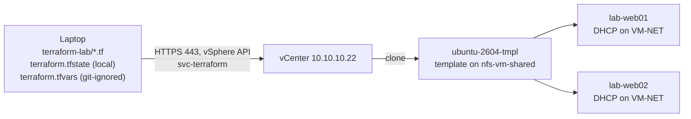

# 12. Terraform for the vSphere Lab

Build lab VMs from code instead of clicking through the New Virtual Machine wizard. Terraform on the laptop talks to vCenter over HTTPS with a least-privilege service account, and vCenter clones an Ubuntu template into new VMs on nfs-vm-shared. One set of files creates two VMs, changes them, adds a third, and removes them all. Everything is free: the Terraform CLI and VMware's vSphere provider.

The code lives in [`terraform-lab/`](../terraform-lab/).



## Values

| Item | Value | Notes |
|---|---|---|
| Terraform | CLI 1.x (free) | OpenTofu works the same with the `tofu` command |
| Provider | `vmware/vsphere` | Moved from `hashicorp/vsphere`; maintained by VMware by Broadcom |
| Runs on | The Mac or Windows laptop | Must reach 10.10.10.22 (service port or the 10.10.0.0/16 route) |
| vCenter account | `svc-terraform@vsphere.local` | Least-privilege role (Part 2) |
| Template | `ubuntu-2604-tmpl`, on nfs-vm-shared | Built once (Part 3); every VM is a clone |
| New VMs | lab-web01, lab-web02 (later lab-web03) | 1 vCPU, 1 GB, DHCP on VM-NET (VLAN 20) |
| Where | Lab-DC > Lab-Cluster, nfs-vm-shared | DRS picks the host; HA protects them |

## How Terraform works

- `.tf` files describe what should exist, not the click-steps.
- `terraform plan` compares the files with the state file (what Terraform built last time) and with vCenter, and shows exactly what it would add, change or delete.
- `terraform apply` makes those changes through vCenter's API and records them in state.
- Change a file and plan/apply again: Terraform only touches what changed. `terraform destroy` removes everything it built, and nothing else.

## Part 1: Install Terraform

```bash
# macOS (Homebrew)
brew tap hashicorp/tap
brew install hashicorp/tap/terraform
terraform -version
```

```powershell
# Windows
winget install --id Hashicorp.Terraform -e
# reopen PowerShell
terraform -version
```

Any recent 1.x release works. VS Code with the HashiCorp Terraform extension is recommended for syntax checking. Then confirm the laptop reaches vCenter: `nc -vz 10.10.10.22 443` (macOS) or `Test-NetConnection 10.10.10.22 -Port 443` (Windows).

## Part 2: A vCenter account just for Terraform

Terraform logs in with its own account and only the rights it needs, not `administrator@vsphere.local`. If its password leaks, it can build and delete VMs in Lab-DC but can't change hosts, networks or vCenter.

**Step 4: Create the user.** Administration > Single Sign On > Users and Groups > Users, domain vsphere.local > Add: `svc-terraform`, a strong password (letters, numbers and hyphens are safest), description *Terraform lab automation*.

**Step 5: Create the role** *Terraform VM Provisioning* (Administration > Access Control > Roles > New):

| Category | Privileges | Used for |
|---|---|---|
| Datastore | Allocate space, Browse datastore, Low level file operations, Remove file, Update virtual machine files | Writing clones' disks to nfs-vm-shared |
| Global | Cancel task | Stopping a task that times out |
| Network | Assign network | Connecting the VM to VM-NET |
| Resource | Assign virtual machine to resource pool | Placing VMs in Lab-Cluster |
| Virtual machine > Change Configuration | All | CPU, memory, disk and NIC settings |
| Virtual machine > Edit Inventory | Create from existing, Create new, Remove | Creating and deleting VMs |
| Virtual machine > Guest operations | All | Reading the guest's IP through VMware Tools |
| Virtual machine > Interaction | All | Power on, power off, shut down |
| Virtual machine > Provisioning | Clone template, Clone virtual machine, Customize guest, Deploy template, Read customization specifications | Cloning and customizing |
| VM storage policies | View VM storage policies, Apply VM storage policies | Default storage policy (vSphere 7 called this *Profile-driven storage*) |

Names are as in the vSphere 8 role editor. If an apply later fails with *Permission to perform this operation was denied*, the error names the missing privilege (for example `VirtualMachine.Config.AddNewDisk`); add it to the role. That's how least-privilege roles are tuned in practice.

**Step 6: Grant the role.**

1. Lab-DC > Add Permission: user `svc-terraform`, role Terraform VM Provisioning, **Propagate to children** ticked.
2. The vCenter root (10.10.10.22) > Add Permission: same user, role **Read-only**, propagate **unticked**. Without it the provider can't look up Lab-DC at all.

Log in as `svc-terraform@vsphere.local` to confirm you see Lab-DC and its contents but can't edit hosts or vCenter, then log back in as administrator.

## Part 3: Build the Ubuntu template

A template is a powered-off master copy that can only be cloned. vSphere guest customization gives each clone its own hostname and network on first boot.

### Step 7: Build one Ubuntu VM

Same build as TS-ROUTER and RANCID-01 ([09-ubuntu-vm-build.md](09-ubuntu-vm-build.md)) with template values:

| Setting | Template value | Why |
|---|---|---|
| VM name / hostname | ubuntu-2604-tmpl / ubuntu-tmpl | Clones get their real names from Terraform |
| Host / datastore | 10.10.10.21 / nfs-vm-shared | Clones land on shared storage, so HA protects them |
| vCPU / RAM / disk | 1 / 2 GB / 20 GB thin | 2 GB gives the installer room; clones get their size from `variables.tf` |
| Network | **VM-NET (VLAN 20), DHCP** | No static address to clean out; clones use DHCP too |
| Per-VM EVC | Intel Haswell Generation | Clones inherit it so they can vMotion between hosts |

- **7a.** The Ubuntu ISO should already be in vmstore > ISO from the TS-ROUTER build. vmstore is ESXI-01's local datastore, which is why the template is built on 10.10.10.21.
- **7b.** Right-click 10.10.10.21 > New Virtual Machine: location Lab-DC, storage nfs-vm-shared, ESXi 8.0 and later, Ubuntu Linux (64-bit), 1 CPU / 2 GB / 20 GB thin, VMware Paravirtual, **VM-NET** with VMXNET 3, CD/DVD from vmstore > ISO. Finish without powering on.
- **7c.** Configure > VMware EVC > **Intel Haswell Generation** (only while powered off), then power on.
- **7d. Install Ubuntu** as in the build guide, with these differences: on the network screen **ens192 should already show DHCPv4 10.10.20.x/24; change nothing** (if it says autoconfiguration failed, the VM isn't on VM-NET); server name **ubuntu-tmpl**; the same admin username on every clone; OpenSSH server on; storage LVM without encryption (a template that asks for a passphrase can't boot its clones unattended).
- **7e.** Set CD/DVD to **Client Device**, log in once, `ip -br a` for the 10.10.20.x address, then SSH in.
- **7f. Baseline:**

```bash
sudo apt update && sudo apt -y full-upgrade
[ -f /var/run/reboot-required ] && sudo reboot
sudo lvextend -r -l +100%FREE /dev/ubuntu-vg/ubuntu-lv
df -h /
sudo timedatectl set-timezone America/New_York
timedatectl | grep synchronized
```

Skipped on purpose from the regular build: the netplan check (Step 8 deletes that file), ufw (stays off, Ubuntu's default), and the vCenter finishing steps (no HA override, snapshot or vMotion test on a template).

### Step 8: Prepare it for cloning

```bash
sudo apt update && sudo apt -y full-upgrade
systemctl is-active open-vm-tools
echo 'disable_vmware_customization: false' | \
  sudo tee /etc/cloud/cloud.cfg.d/99-vmware-customization.cfg
sudo rm -f /etc/netplan/00-installer-config.yaml /etc/netplan/50-cloud-init.yaml
sudo cloud-init clean --logs
sudo truncate -s 0 /etc/machine-id
history -c && sudo shutdown -h now
```

| Line | What it does |
|---|---|
| `apt full-upgrade` | Clones start patched; patch the template every month or two |
| `is-active open-vm-tools` | Must print `active`: guest customization runs through VMware Tools |
| `99-vmware-customization.cfg` | Tells cloud-init to accept vSphere's customization (hostname, network) |
| `rm` netplan files | Removes the template's own network file, so a clone only gets what customization writes |
| `cloud-init clean` | Next boot counts as a first boot, so each clone gets fresh SSH host keys |
| `truncate machine-id` | Each clone generates its own machine ID, so DHCP doesn't hand two clones the same address |
| `shutdown` | A template must be powered off |

### Step 9: Convert it to a template

Once ubuntu-2604-tmpl shows Powered Off, confirm CD/DVD is Client Device and EVC still shows Haswell, then right-click > Template > **Convert to Template**. It moves to the VMs and Templates view.

To update it later: Convert to Virtual Machine, power on, patch, rerun Step 8, convert back.

## Part 4: The Terraform files

The files are in [`terraform-lab/`](../terraform-lab/): `versions.tf`, `provider.tf`, `variables.tf`, `main.tf`, `outputs.tf`, `.gitignore`, and `terraform.tfvars.example`.

| Block | What it does |
|---|---|
| `data` blocks | Look up Lab-DC, Lab-Cluster, nfs-vm-shared, VM-NET and the template by name. Terraform never changes these |
| `resource ... for_each = var.vms` | One VM per entry in the `vms` map; `each.key` is the name, `each.value` its size |
| `resource_pool_id` | The cluster's root resource pool, so DRS chooses the host |
| `guest_id`, `firmware`, `scsi_type`, `adapter_type`, `disk` | Copied from the template so the clone's hardware matches |
| `clone` / `customize` | Clone the template, set hostname and DHCP networking on first boot through VMware Tools |

The `vms` map in `variables.tf` is the whole inventory: add a line to add a VM, change a number to resize, remove a line to delete.

**Credentials.** Copy `terraform.tfvars.example` to `terraform.tfvars` and fill in the real password, or skip the file and set an environment variable per session: `export TF_VAR_vsphere_password='...'` (macOS) or `$env:TF_VAR_vsphere_password='...'` (Windows).

> **Secrets stay off GitHub.** `terraform.tfvars` holds the password and `terraform.tfstate` can hold sensitive values; both are git-ignored, along with `.terraform/`. Do commit `.terraform.lock.hcl` after the first `terraform init` so every run uses the same provider version.

## Part 5: Build, change and destroy

```bash
cd terraform-lab
terraform init                       # downloads vmware/vsphere, writes .terraform.lock.hcl
terraform fmt && terraform validate  # "Success! The configuration is valid."
terraform plan                       # read the last line: "Plan: 2 to add, 0 to change, 0 to destroy."
terraform apply                      # type yes
```

In plan output, `+` is create, `~` change in place, `-` destroy and `-/+` destroy and recreate. During apply, vCenter shows Clone virtual machine, Customize virtual machine and Power On for each VM; Terraform waits until each reports an IP through VMware Tools, then prints `vm_ip_addresses` (addresses from CORE-SW1's VLAN 20 pool).

**Step 14: Check the result.**

| # | Where | Expect |
|---|---|---|
| 1 | Lab-Cluster > VMs | lab-web01 and lab-web02 powered on, on nfs-vm-shared (DRS may split them across hosts) |
| 2 | Each VM > Summary | DNS name `lab-web01.lab.local`, VMware Tools Running, the IP from the output |
| 3 | `ssh <admin-user>@<IP>` | Prompt shows the clone's name, not ubuntu-tmpl |
| 4 | Each VM > Configure > VMware EVC | Intel Haswell inherited from the template |
| 5 | Lab-Cluster > Monitor > vSphere HA | Both VMs protected |
| 6 | `terraform state list` | The five data sources and two VM resources |

**Step 15: Change something.** In `variables.tf`, give lab-web02 two CPUs and add lab-web03:

```hcl
default = {
  "lab-web01" = { cpus = 1, memory_mb = 1024 }
  "lab-web02" = { cpus = 2, memory_mb = 1024 } # was 1
  "lab-web03" = { cpus = 1, memory_mb = 1024 } # new
}
```

`terraform plan` shows *1 to add, 1 to change, 0 to destroy* and doesn't mention lab-web01. With CPU hot-add off, the provider shuts lab-web02 down cleanly, changes it and powers it back on, so expect a brief outage for that VM.

**Drift:** change something by hand in vCenter (for example give lab-web01 2 GB) and `terraform plan` plans to put it back. The files are the source of truth.

**Step 16: Destroy.** `terraform destroy` (type yes) removes the three lab-web VMs and their files on nfs-vm-shared. The template, Lab-Cluster, VM-NET and every VM Terraform didn't create (vcsa, veeam01, TS-ROUTER, RANCID-01) are untouched: Terraform only destroys what its state says it built. To remove just one VM, delete its line from the map and apply.

**Step 17: Commit.** `git status` should list the `.tf` files, `.gitignore` and `.terraform.lock.hcl`, but **no** `terraform.tfvars`, `*.tfstate` or `.terraform/`.

## Where to go next

- **Static IPs:** replace the empty `network_interface {}` in `customize` with `ipv4_address` and `ipv4_netmask`, add `ipv4_gateway` and `dns_server_list`, and put the address in the `vms` map.
- **A VM folder:** create a *Terraform* folder in Lab-DC and set `folder = "Terraform"` on the resource.
- **Modules:** move the VM resource into a reusable module per role (web, db).
- **OpenTofu:** `tofu init`, `plan`, `apply` on the same folder; nothing in the files changes.
- **Ansible next:** Terraform builds VMs; a configuration tool then installs software on them. The IP output is a natural hand-off.

## Commands

| Command | What it does |
|---|---|
| `terraform -version` | Show the installed version |
| `terraform init` | Download the provider and prepare the folder |
| `terraform fmt` | Tidy formatting |
| `terraform validate` | Check the files without contacting vCenter |
| `terraform plan` | Show what would be added, changed or destroyed |
| `terraform apply` | Make the changes (asks for yes) |
| `terraform output` | Print outputs again, such as the VM IPs |
| `terraform state list` | List what Terraform manages |
| `terraform destroy` | Remove everything this folder built (asks for yes) |

## Troubleshooting

| Symptom | Likely cause | Fix |
|---|---|---|
| init: provider moved to vmware/vsphere | Old example uses hashicorp/vsphere | `source = "vmware/vsphere"`, then `terraform init -upgrade` |
| Cannot complete login: incorrect user name or password | Wrong user format or password | User must be `svc-terraform@vsphere.local` |
| datacenter 'Lab-DC' not found | No read-only permission at the vCenter root, or a typo | Step 6, item 2; names are case-sensitive |
| Permission to perform this operation was denied | Privilege missing from the role | The error names it; add it to the role |
| ubuntu-2604-tmpl not found | Name differs, or it's still a VM | Check VMs and Templates; Step 9 |
| Apply times out waiting for an IP | Customization failed, or no DHCP on VM-NET | Check the console hostname and `ip -br a`; recheck Step 8 lines 3 to 5; check CORE-SW1's VLAN 20 pool |
| Clone keeps hostname ubuntu-tmpl | cloud-init ignored vSphere customization | Recheck the `99-vmware-customization.cfg` and `cloud-init clean`, reconvert the template |
| Two clones get the same IP | Template machine-id not cleared | Run the truncate line, reconvert, destroy and re-apply |
| Clones show per-VM EVC disabled | Setting didn't carry over | Power off, set Haswell, power on (needed only for vMotion to ESXI-N1) |
| Power on fails: VT-x ... VHV disabled | DRS placed the clone on 10.10.10.24 without nested virtualization on the ESXI-N1 VM | Tick Expose hardware assisted virtualization on the ESXI-N1 VM |
| x509: certificate signed by unknown authority | `allow_unverified_ssl` missing | Keep `allow_unverified_ssl = true` for this lab |
| Plan wants to change VMs you didn't edit | Someone changed them in vCenter (drift) | Put the change in the files or let apply reset it |
| Lost `terraform.tfstate` | State is how Terraform knows what it built | Delete the lab-web VMs by hand, then apply from scratch |
